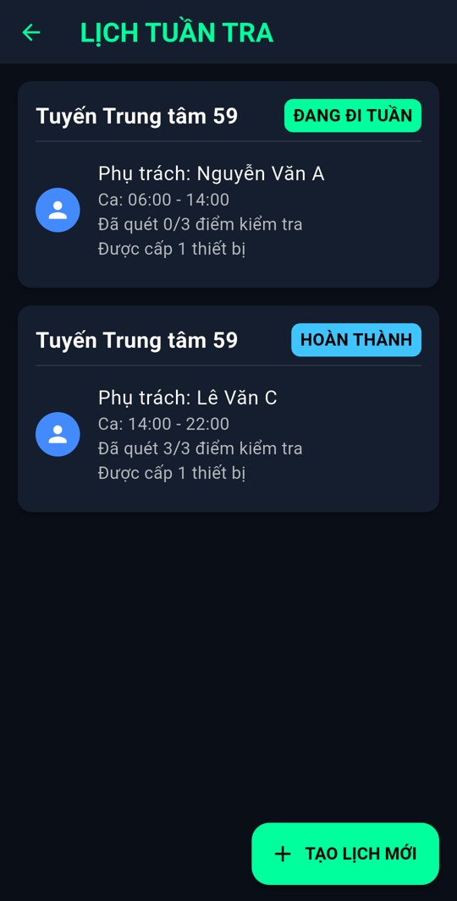
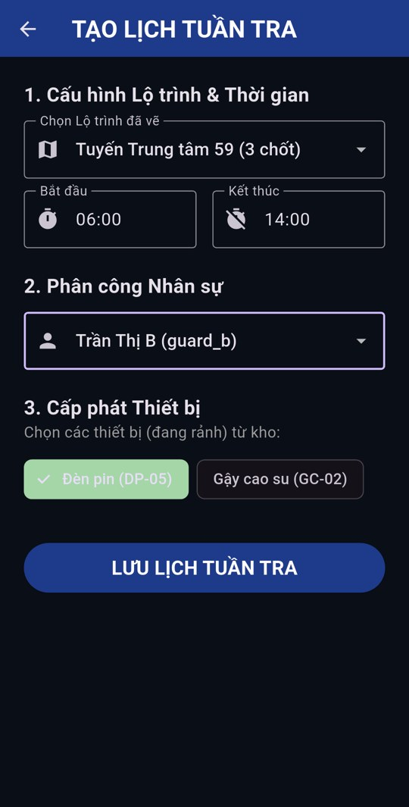

# BÁO CÁO ĐỒ ÁN CUỐI KỲ

---

## 1. TRANG BÌA

| | |
|---|---|
| **Trường / Khoa** | `[Điền tên Trường / Khoa]` |
| **Học phần** | Lập trình trên thiết bị di động (ECMP177) |
| **Tên đề tài** | Ứng dụng Quản lý Tuần tra Bảo vệ – *Tactical Patrol Ops* |
| **Thành viên** | `[Họ tên – MSSV]` `[Họ tên – MSSV]` |
| **Lớp / Nhóm** | `[Lớp] / [Nhóm]` |
| **Giảng viên phụ trách** | ThS. Bùi Phú Khuyên |
| **Học kỳ – Năm học** | `[Học kỳ] – [Năm học]` |

---

## 2. KẾT QUẢ THỰC NGHIỆM

### 2.1. Tổng hợp chức năng, công nghệ sử dụng & Link Git dự án

**Link Git dự án (public):** `[Dán link GitHub/GitLab ở chế độ công khai]`

#### a. Tổng quan công nghệ sử dụng

| Thành phần | Công nghệ / Thư viện | Mục đích sử dụng |
|---|---|---|
| Mobile App | Flutter 3.47 / Dart 3.13 | Xây dựng ứng dụng di động (chạy được Android, iOS, Web) |
| Kiến trúc | Clean Architecture (domain / data / presentation) | Tách lớp nghiệp vụ, dữ liệu và giao diện |
| State Management | flutter_riverpod 2.x (`StateNotifierProvider`, `StreamProvider`) | Quản lý trạng thái lịch tuần tra, sự cố, nhân sự, thiết bị, vị trí GPS |
| Định vị | geolocator | Lấy vị trí GPS thời gian thực, tính khoảng cách đến điểm tuần tra (Geofencing) |
| Quét mã QR | mobile_scanner | Dùng camera quét mã QR tại điểm kiểm tra, bật đèn flash, đổi camera |
| Phân quyền thiết bị | permission_handler | Xin quyền Camera trước khi quét QR / chụp ảnh |
| Xác thực sinh trắc học | local_auth | Đăng nhập bằng vân tay / khuôn mặt |
| Local Storage | shared_preferences | Lưu sự cố, lịch, lộ trình, nhân sự, thiết bị dạng JSON – dữ liệu còn nguyên khi mở lại app |
| Camera / Ảnh | image_picker | Chụp ảnh hoặc chọn ảnh hiện trường đính kèm báo cáo sự cố |
| Ghi âm / Phát âm thanh | record, audioplayers, path_provider | Ghi âm hiện trường và phát lại; phát còi báo cháy lặp liên tục |
| Mã QR | qr_flutter | Sinh mã QR cho từng điểm tuần tra để in và dán tại hiện trường |
| Bản đồ | flutter_map, latlong2 + nền bản đồ OpenStreetMap | Bản đồ thật (đường phố, tòa nhà) để vẽ lộ trình, chấm điểm, quét bản đồ khu vực, giám sát; không cần API key |
| Radar | CustomPainter | Radar quét vị trí và tiến độ khi tuần tra |
| Cơ sở dữ liệu / Backend | *Chưa có máy chủ* – lưu cục bộ trên thiết bị (SharedPreferences) | Dữ liệu chỉ nằm trên một máy, chưa đồng bộ giữa nhiều thiết bị |
| Kiểm thử | flutter_test | 52 Unit / Widget test, `flutter analyze` không còn lỗi |

#### b. Tổng hợp các chức năng (theo phân quyền)

| STT | Phân quyền / Module | Chức năng | Trạng thái |
|:-:|---|---|---|
| 1 | Chung – Tài khoản | Đăng nhập bằng mã PIN, phân quyền Bảo vệ / Chỉ huy; mỗi bảo vệ có PIN riêng | Hoàn thành |
| 2 | Chung – Tài khoản | Báo lỗi khi nhập sai PIN, hiệu ứng chờ, rung phản hồi | Hoàn thành |
| 3 | Chung – Tài khoản | Đăng nhập sinh trắc học (vân tay / khuôn mặt) cho bảo vệ đã đăng nhập PIN trên máy | Hoàn thành (chỉ trên thiết bị thật có cảm biến) |
| 4 | Chung – Tài khoản | Đăng xuất | Hoàn thành |
| 5 | Chung – Tài khoản | Mật khẩu / tài khoản xác thực trên máy chủ | Chưa xây dựng – PIN lưu cục bộ, chưa mã hóa |
| 6 | Bảo vệ – Ca trực | Xem ca trực hiện tại (giờ, tuyến, tiến độ, trạng thái) | Hoàn thành |
| 7 | Bảo vệ – Ca trực | Xem chi tiết ca: bản đồ lộ trình, đường đã đi, danh sách điểm, thiết bị được cấp | Hoàn thành |
| 8 | Bảo vệ – Tuần tra | Theo dõi vị trí GPS & radar tiến độ | Hoàn thành (mặc định dùng GPS giả lập để demo) |
| 9 | Bảo vệ – Tuần tra | Geofencing: chỉ cho quét khi ở trong bán kính điểm (15 m) | Hoàn thành |
| 10 | Bảo vệ – Tuần tra | Quét mã QR bằng camera tại 3 điểm Nhà kho / Nhà xe / Hành lang, đối chiếu mã đúng / sai (không phân biệt hoa thường) | Hoàn thành (trên điện thoại); bản Web dùng màn hình quét giả lập |
| 11 | Bảo vệ – Tuần tra | Cập nhật tiến độ & trạng thái ca (Đang đi tuần → Hoàn thành), ghi lại vị trí mỗi lần quét | Hoàn thành |
| 12 | Bảo vệ – Tuần tra | Đồng bộ ngoại tuyến (Offline Sync) | Chưa hoàn thiện – mới mô phỏng trạng thái "Đang chờ mạng → Đã đồng bộ" |
| 13 | Bảo vệ – Sự cố | Báo cáo sự cố (tiêu đề, mô tả, 4 mức độ) bằng thao tác vuốt | Hoàn thành |
| 14 | Bảo vệ – Sự cố | Chụp / chọn ảnh hiện trường (bắt buộc với mức KHẨN CẤP), xem ảnh phóng to | Hoàn thành |
| 15 | Bảo vệ – Sự cố | Ghi âm hiện trường kèm báo cáo, nghe lại / xóa / ghi lại | Hoàn thành (trên điện thoại; bản Web ẩn chức năng) |
| 16 | Bảo vệ – Sự cố | Theo dõi sự cố của mình / được điều động chi viện, báo cáo xử lý | Hoàn thành |
| 17 | Bảo vệ – Báo cháy | Nút BÁO CHÁY: chọn vị trí, xác nhận, phát còi và cảnh báo nhấp nháy tới Chỉ huy và các bảo vệ | Hoàn thành |
| 18 | Bảo vệ – Chấm công | Vào ca / kết thúc ca theo lịch trực; tự tính đi trễ (quá 10 phút) và số giờ làm | Hoàn thành |
| 19 | Bảo vệ – Chấm công | Xem công cá nhân theo tháng (số ca, giờ, đi trễ, ngày phép, ca vắng) và lịch trực tuần của mình | Hoàn thành |
| 20 | Bảo vệ – Nghỉ phép | Gửi đơn xin nghỉ (từ ngày – đến ngày, lý do), theo dõi trạng thái Chờ duyệt / Đã duyệt / Từ chối | Hoàn thành |
| 21 | Chỉ huy – Tổng quan | Dashboard thống kê: tuyến đang trực, nhân sự đi tuần, sự cố chờ xử lý (tính từ dữ liệu thật) | Hoàn thành |
| 22 | Chỉ huy – Giám sát | Giám sát các ca đang đi tuần: bản đồ đường đã đi, tiến độ, lần quét cuối, điểm kế tiếp | Hoàn thành (dữ liệu trên cùng thiết bị, chưa theo dõi thời gian thực từ máy khác) |
| 23 | Chỉ huy – Sự cố | Danh sách & chi tiết sự cố (ảnh, ghi âm), điều động chi viện, đóng sự cố kèm ghi chú | Hoàn thành |
| 24 | Chỉ huy – Lộ trình | Vẽ lộ trình, chấm điểm, hoàn tác, đổi tên điểm; danh sách & xóa lộ trình | Hoàn thành |
| 25 | Chỉ huy – Lộ trình | Sinh mã QR cho từng điểm tuần tra để in và dán | Hoàn thành |
| 26 | Chỉ huy – Bản đồ | Quét bản đồ khu vực lần đầu bằng cách đi một vòng (giả lập bước đi hoặc GPS thật); đường đã quét làm bản đồ nền cho mọi màn hình bản đồ | Hoàn thành |
| 27 | Chỉ huy – Lịch tuần tra | Tạo lịch: chọn lộ trình, giờ ca, bảo vệ, cấp phát thiết bị đang rảnh | Hoàn thành |
| 28 | Chỉ huy – Lịch tuần tra | Theo dõi tiến độ quét từng ca; hủy lịch (thu hồi thiết bị) | Hoàn thành |
| 29 | Chỉ huy – Lịch trực | Phân ca trực (Sáng / Chiều / Tối), lên lịch trực theo tuần, sao chép lịch tuần trước; chặn trùng ca và người đang nghỉ phép | Hoàn thành |
| 30 | Chỉ huy – Chấm công | Bảng công tổng theo tháng và chi tiết công từng nhân viên | Hoàn thành |
| 31 | Chỉ huy – Nghỉ phép | Duyệt / từ chối đơn nghỉ kèm ghi chú; tự gỡ ca trực trong những ngày được nghỉ | Hoàn thành |
| 32 | Chỉ huy – Nhân sự | Xem danh sách & hồ sơ chi tiết | Hoàn thành |
| 33 | Chỉ huy – Nhân sự | Thêm / sửa (ràng buộc SĐT, tuổi, mã NV và PIN không trùng) / vuốt để xóa | Hoàn thành |
| 34 | Chỉ huy – Nhân sự | Đánh dấu nhân viên đã nghỉ việc (không đăng nhập được), xóa hàng loạt nhân viên đã nghỉ cùng lịch trực | Hoàn thành |
| 35 | Chỉ huy – Thiết bị | Thêm / sửa / xóa thiết bị; tự chuyển Đang cấp khi phân công và thu hồi khi hết ca | Hoàn thành |
| 36 | Hệ thống | Lưu dữ liệu cục bộ, còn nguyên khi tắt / mở lại app; khôi phục dữ liệu mẫu; tự nâng cấp dữ liệu khi cập nhật phiên bản | Hoàn thành |
| 37 | Hệ thống | CSDL / Backend đồng bộ nhiều thiết bị | Chưa xây dựng |
| 38 | Hệ thống | Thông báo đẩy cho Chỉ huy khi có sự cố | Chưa xây dựng – cần tài khoản dịch vụ (Firebase / OneSignal) |

---

### 2.2. Minh họa chi tiết các chức năng

> Ảnh bên dưới được chụp trên điện thoại thật Samsung SM-M307F (Android 11) chạy bản APK release; mã QR được quét thật bằng camera.

#### Chức năng 1: Đăng nhập bằng mã PIN

**Mô tả:** Người dùng nhập mã PIN 4 số trên bàn phím số. Mỗi lần chạm, ô vuông tương ứng được tô sáng và điện thoại rung nhẹ. Khi đủ 4 số, ứng dụng hiển thị vòng xoay chờ xác thực rồi điều hướng theo vai trò: mỗi bảo vệ có PIN riêng (dữ liệu mẫu: Nguyễn Văn A `1234`, Trần Thị B `2345`, Lê Văn C `3456`) và chỉ thấy ca trực, sự cố của chính mình; PIN `5678` vào Trung tâm Chỉ huy. Nhập sai, ứng dụng rung mạnh, xóa mã đã nhập và báo "TỪ CHỐI TRUY CẬP". Nút xóa (⌫) xóa từng chữ số. Nút vân tay đăng nhập lại tài khoản bảo vệ đã dùng PIN gần nhất trên máy; nếu chưa từng đăng nhập PIN, ứng dụng báo "HÃY ĐĂNG NHẬP BẰNG PIN LẦN ĐẦU", nếu thiết bị không có cảm biến thì báo "THIẾT BỊ KHÔNG HỖ TRỢ SINH TRẮC HỌC".

#### Chức năng 2: Dashboard Bảo vệ – Ca trực hiện tại

**Mô tả:** Sau khi đăng nhập, đầu trang là thẻ chấm công và lịch trực tuần (xem Chức năng 15). Mục "CA TUẦN TRA" hiển thị ca tuần tra được Chỉ huy phân công: khung giờ (06:00 – 14:00), tên tuyến, số điểm đã quét trên tổng số điểm và nhãn trạng thái (Chưa bắt đầu / Đang đi tuần / Hoàn thành). Bên dưới là "Bảng theo dõi sự cố" gồm các sự cố do chính bảo vệ báo cáo hoặc được Chỉ huy điều động chi viện. Nếu chưa được phân công, màn hình hiển thị "Bạn chưa được phân công ca trực nào". Thanh "VUỐT ĐỂ BÁO CÁO" phải kéo hết hành trình mới mở form báo sự cố, tránh bấm nhầm khi đang di chuyển.

#### Chức năng 3: Chi tiết ca trực

**Mô tả:** Chạm vào thẻ ca trực để xem lộ trình trên bản đồ thật OpenStreetMap (đường phố, tên đường; đường đi dự kiến là nét đứt xanh đậm, điểm chưa quét màu cam, điểm đã quét màu xanh lá kèm vòng tròn bán kính 15 m), thời gian ca, thứ tự các điểm (Nhà Kho → Nhà Xe → Hành Lang), đường đã đi thực tế (nối các vị trí đã quét) và thiết bị được cấp phát. Nút "BẮT ĐẦU TUẦN TRA NGAY" chuyển trạng thái ca sang "Đang đi tuần" và mở màn hình tuần tra. Nếu ca đang dở, nút đổi thành "TIẾP TỤC TUẦN TRA"; ca đã hoàn thành thì nút bị khóa.

#### Chức năng 4: Tuần tra theo GPS & Geofencing

| Ở xa điểm tuần tra | Đã vào bán kính 15 m |
|:-:|:-:|
|  |  |

**Mô tả:** Màn hình hiển thị radar quét vị trí và phần trăm hoàn thành. Mỗi điểm tuần tra có tọa độ và khoảng cách từ bảo vệ đến điểm (tính bằng công thức Haversine). Khi khoảng cách lớn hơn bán kính cho phép (15 m), nút bị khóa với chữ "QUÁ XA ĐỂ QUÉT" (màu xám); bấm vào sẽ báo "BẠN ĐANG Ở QUÁ XA MỤC TIÊU! KHÔNG THỂ QUÉT". Khi bảo vệ đi vào trong bán kính, thẻ điểm chuyển viền xanh và nút đổi thành "MỞ CAMERA QUÉT QR". Cơ chế này ngăn việc check-in khống từ xa. Ở chế độ demo, vị trí được giả lập tự di chuyển dần đến điểm kế tiếp; chạy với `--dart-define=USE_REAL_GPS=true` để dùng GPS thật.

#### Chức năng 5: Quét mã QR tại điểm kiểm tra

| Màn hình quét | Sau khi quét điểm đầu tiên |
|:-:|:-:|
|  |  |

**Mô tả:** Trên điện thoại, ứng dụng xin quyền Camera rồi mở trình quét có khung ngắm và tia laser. Mã quét được đối chiếu với mã QR quy định của điểm: đúng thì rung, báo "XÁC NHẬN MỤC TIÊU THÀNH CÔNG" và quay lại; sai thì báo đỏ "Sai mã QR" kèm mã cần quét và tạm khóa 2 giây. Việc so khớp bỏ qua chữ hoa / thường và khoảng trắng thừa. Có nút bật đèn flash khi tuần tra ban đêm và nút đổi camera. Sau khi quét, điểm chuyển sang "ĐANG CHỜ MẠNG..." rồi "ĐÃ ĐỒNG BỘ MÁY CHỦ", tiến độ tăng lên 33%, vị trí quét được ghi vào đường đã đi của ca. (Bản chạy trên Web dùng màn hình quét giả lập vì không có camera.)

Tuyến mẫu "Tuyến Trung tâm 59" đặt tại Trung tâm Giáo dục 59 (59 Phạm Thị Lòng, xã Bình Mỹ, TP.HCM – tọa độ 10.98919, 106.57981), gồm 3 điểm tuần tra cách nhau 40 – 80 m; mỗi điểm dán một mã QR với nội dung tương ứng: **Nhà kho** (`nhà kho`), **Nhà xe** (`nhà xe`), **Hành lang** (`hành lang`). Bộ mã in sẵn nằm trong thư mục `docs/qr/` (3 ảnh riêng và 1 trang A4 gồm cả 3 mã).

| Mã QR điểm Nhà kho | Mã QR điểm Nhà xe | Mã QR điểm Hành lang |
|:-:|:-:|:-:|
|  |  |  |

#### Chức năng 6: Hoàn thành ca tuần tra

| Quét đủ 3 điểm | Ca trực chuyển Hoàn thành |
|:-:|:-:|
|  |  |

**Mô tả:** Khi quét đủ các điểm, radar báo "ĐÃ HOÀN TẤT 100%" và hiện dải thông báo "HOÀN THÀNH TUẦN TRA: 3/3 ĐIỂM". Trạng thái ca tự chuyển sang "HOÀN THÀNH", Chỉ huy nhìn thấy ngay trong màn hình Lịch tuần tra.

#### Chức năng 7: Báo cáo sự cố

| Đang ghi âm hiện trường | Đã ghi âm, nghe lại / xóa |
|:-:|:-:|
|  |  |

**Mô tả:** Bảo vệ vuốt thanh "VUỐT ĐỂ BÁO CÁO" để mở form, nhập tiêu đề, mô tả và chọn một trong 4 mức độ: Thấp, Vừa, Cao, Khẩn cấp. Ứng dụng kiểm tra: thiếu tiêu đề hoặc mô tả thì báo "Vui lòng nhập Tiêu đề và Mô tả"; chọn mức KHẨN CẤP mà chưa có ảnh hiện trường thì báo lỗi bắt buộc đính kèm ảnh. Nút "CHỤP ẢNH" mở camera (xin quyền Camera nếu chưa có), nút "THƯ VIỆN" chọn ảnh có sẵn; ảnh được thu nhỏ, hiển thị xem trước và có thể bỏ hoặc chụp lại. Nút "GHI ÂM HIỆN TRƯỜNG" xin quyền Micro rồi ghi âm (hiển thị thời gian đang ghi); bấm lần nữa để dừng, sau đó có thể nghe lại, xóa hoặc ghi lại. File ghi âm lưu trong bộ nhớ ứng dụng và phát lại được trong chi tiết sự cố. Bấm "TRUYỀN TIN CẢNH BÁO", sự cố mang tên bảo vệ đang đăng nhập được gửi về Trung tâm Chỉ huy, xuất hiện trong bảng theo dõi của bảo vệ và làm tăng số "Sự cố khẩn" trên dashboard Chỉ huy.

#### Chức năng 8: Trung tâm Chỉ huy (Dashboard)

| Phần trên: cảnh báo & thống kê | Các chức năng quản lý |
|:-:|:-:|
|  |  |

**Mô tả:** Chỉ huy đăng nhập bằng PIN `5678`. Phía trên là 3 chỉ số tính trực tiếp từ dữ liệu: số tuyến đang trực, số bảo vệ đang đi tuần và số sự cố chưa xử lý. Nút khôi phục (↺) trên thanh tiêu đề xóa dữ liệu đã lưu và đưa ứng dụng về dữ liệu mẫu ban đầu (có hộp thoại xác nhận). Khi có sự cố chưa xử lý, thẻ "QUẢN LÝ SỰ CỐ" chuyển viền đỏ kèm dòng "Có N sự cố cần duyệt ngay!". Khi khu vực chưa có bản đồ, đầu trang hiện thẻ "QUÉT BẢN ĐỒ LẦN ĐẦU". Các thẻ bên dưới dẫn đến Lịch tuần tra, Nhân sự, Thiết bị, Lộ trình & QR, Lịch trực tuần, Chấm công, Nghỉ phép (kèm số đơn chờ duyệt), Bản đồ và Giám sát tuần tra.

#### Chức năng 9: Quản lý & xử lý sự cố

| Danh sách sự cố | Chi tiết sự cố |
|:-:|:-:|
|  |  |

**Mô tả:** Danh sách hiển thị các sự cố với viền đỏ (chưa xử lý) hoặc xanh (đã đóng); khi không có sự cố, màn hình báo "Tuyệt vời! Không có sự cố nào.". Mở chi tiết, Chỉ huy xem tiêu đề, mô tả, thời gian, người báo cáo, ảnh hiện trường (chạm để phóng to) và nút nghe bản ghi âm nếu có. Nút "CHI VIỆN" mở danh sách bảo vệ đang đi tuần để chọn và điều động; bảo vệ được chọn sẽ thấy sự cố trong mục "Yêu cầu tôi chi viện". Chỉ huy nhập "Ghi chú chỉ đạo" và bấm "ĐÓNG SỰ CỐ": sự cố chuyển màu xanh, ghi "ĐÃ ĐÓNG BỞI: CHỈ HUY" và số sự cố khẩn trên dashboard giảm đi.

#### Chức năng 10: Lộ trình, vẽ lộ trình & mã QR điểm tuần tra

| Danh sách lộ trình | Mã QR các điểm | Vẽ lộ trình |
|:-:|:-:|:-:|
|  |  |  |

**Mô tả:** Chỉ huy nhập tên lộ trình, chọn chế độ "VẼ ĐƯỜNG ĐI" rồi chạm lên bản đồ để tạo các đỉnh của đường đi; chuyển sang "CHẤM ĐIỂM" để đặt các điểm tuần tra (mỗi điểm tự sinh tên và mã QR, bán kính 15 m). Lộ trình được vẽ trực tiếp trên bản đồ thật (OpenStreetMap): kéo để di chuyển, chụm hai ngón để phóng to, mỗi lần chạm lấy đúng tọa độ GPS của vị trí đó; vòng tròn quanh mỗi điểm thể hiện bán kính 15 m thật trên bản đồ. Nút "HOÀN TÁC" bỏ nét / điểm vừa thêm, chạm vào tên điểm để đổi tên (VD: "Cổng sau"). Nếu thiếu tên, đường đi dưới 2 nét hoặc chưa có điểm nào, ứng dụng báo lỗi; lưu thành công thì lộ trình xuất hiện trong danh sách và khi tạo lịch. Mở một lộ trình để xem bản đồ và mã QR của từng điểm (kèm tên, mã, tọa độ, bán kính) để in và dán đúng vị trí – đây chính là mã bảo vệ phải quét khi đi tuần. Vuốt để xóa lộ trình; lộ trình đang được dùng trong lịch chưa hoàn thành sẽ không cho xóa.

#### Chức năng 11: Lịch tuần tra & Tạo lịch

| Danh sách lịch | Tạo lịch mới |
|:-:|:-:|
|  |  |

**Mô tả:** Danh sách lịch hiển thị tuyến (VD: Tuyến Trung tâm 59 – 3 chốt), trạng thái (màu cam: chưa bắt đầu, xanh lá: đang đi tuần, xanh dương: hoàn thành), người phụ trách, giờ ca, số điểm đã quét và số thiết bị được cấp. Bấm "TẠO LỊCH MỚI" để chọn lộ trình đã vẽ, nhập giờ bắt đầu / kết thúc (định dạng HH:mm, giờ kết thúc phải sau giờ bắt đầu), chọn bảo vệ và chọn thiết bị. Chỉ thiết bị đang "SẴN SÀNG" mới hiện để chọn; sau khi lưu, thiết bị chuyển sang "ĐANG CẤP" và tự được thu hồi về kho khi ca hoàn thành. Vuốt một lịch sang trái để hủy lịch (thiết bị cũng được thu hồi).

#### Chức năng 12: Quản lý nhân sự

| Danh sách | Thêm nhân sự | Hồ sơ chi tiết |
|:-:|:-:|:-:|
|  |  |  |

**Mô tả:** Danh sách hiển thị họ tên, vai trò, mã nhân viên và số điện thoại. Nút "+" mở form thêm mới; biểu tượng bút chì mở form sửa. Ràng buộc dữ liệu: bắt buộc họ tên và mã NV, mã NV không được trùng, số điện thoại gồm 10 chữ số bắt đầu bằng 0, tuổi từ 18 đến 65, mã PIN đăng nhập gồm 4 chữ số và không trùng với bảo vệ khác hay PIN Chỉ huy; dữ liệu sai sẽ báo lỗi màu đỏ và không lưu. Vuốt một dòng sang trái, xác nhận "XÓA" để xóa nhân sự. Chạm vào dòng để xem hồ sơ chi tiết (tài khoản, SĐT, giới tính, tuổi, ghi chú kinh nghiệm).

#### Chức năng 13: Quản lý thiết bị

**Mô tả:** Danh sách thiết bị (Bộ đàm, Đèn pin...) kèm mã và nhãn trạng thái màu xanh "SẴN SÀNG" hoặc màu cam "ĐANG CẤP". Chỉ huy có thể thêm, sửa tên / mã / trạng thái và vuốt để xóa thiết bị. Trạng thái thiết bị liên kết với lịch tuần tra: thiết bị đã cấp phát sẽ không xuất hiện khi tạo lịch mới.

#### Chức năng 14: Giám sát tuần tra

**Mô tả:** Từ thẻ "GIÁM SÁT" trên dashboard, Chỉ huy xem bản đồ của ca đang đi tuần: đường dự kiến, các điểm tuần tra (điểm đã quét đổi màu) và đường đã đi thực tế nối các vị trí quét. Bản đồ là bản đồ thật, có thể kéo và phóng to. Bên dưới là danh sách các ca đang đi tuần với tên bảo vệ, giờ ca, thanh tiến độ, số điểm đã quét, giờ quét gần nhất và điểm kế tiếp; chạm vào ca nào thì bản đồ hiển thị ca đó. Khi không có ca nào đang diễn ra, màn hình báo "Hiện không có ca tuần tra nào đang diễn ra.". Vì chưa có Backend, màn hình hiển thị dữ liệu trên cùng thiết bị.

#### Chức năng 15: Chấm công của bảo vệ

| Thẻ chấm công trên dashboard | Công cá nhân theo tháng |
|:-:|:-:|
|  |  |

**Mô tả:** Đầu dashboard của bảo vệ là thẻ "CHẤM CÔNG" lấy ca trực trong ngày từ lịch trực tuần (VD: Ca Sáng 06:00 – 14:00). Nút "VÀO CA" chỉ bấm được từ 30 phút trước giờ bắt đầu đến khi hết ca; vào trễ quá 10 phút sẽ ghi nhận số phút trễ. Khi xong ca bấm "KẾT THÚC CA", ứng dụng tính số giờ làm. Bên dưới là dải lịch trực tuần này (S: sáng, C: chiều, T: tối, P: nghỉ phép) và hai nút "CÔNG CỦA TÔI", "XIN NGHỈ PHÉP". Màn hình công cá nhân cho chọn tháng, hiển thị số ca đã làm, tổng giờ, số lần và số phút đi trễ, ngày nghỉ phép, ca vắng (có lịch nhưng không chấm công) và danh sách từng lần chấm công.

#### Chức năng 16: Xin nghỉ phép & duyệt nghỉ phép

| Bảo vệ gửi đơn | Chỉ huy duyệt đơn |
|:-:|:-:|
|  |  |

**Mô tả:** Bảo vệ chọn ngày bắt đầu, ngày kết thúc (bằng lịch chọn ngày), nhập lý do và bấm "GỬI ĐƠN". Ứng dụng kiểm tra: phải có lý do, không xin cho ngày đã qua, ngày kết thúc không trước ngày bắt đầu và không trùng với đơn khác. Đơn hiện ở mục "ĐƠN CỦA TÔI" với nhãn Chờ duyệt / Đã duyệt / Từ chối. Trên dashboard Chỉ huy, thẻ "NGHỈ PHÉP (n)" cho biết số đơn đang chờ. Chỉ huy bấm "DUYỆT" hoặc "TỪ CHỐI" và có thể ghi chú; khi duyệt, các ca trực của nhân viên trong những ngày nghỉ được tự động gỡ khỏi lịch, và từ đó không thể phân ca cho người này vào ngày nghỉ.

#### Chức năng 17: Phân ca trực & lịch trực tuần

**Mô tả:** Màn hình "LỊCH TRỰC TUẦN" hiển thị 7 ngày của tuần, mỗi ngày có 3 ca: Sáng (06:00 – 14:00), Chiều (14:00 – 22:00), Tối (22:00 – 06:00). Nút mũi tên chuyển tuần trước / tuần sau, ngày hôm nay được viền xanh và dòng "Nghỉ phép: …" cho biết ai đang nghỉ. Bấm "+" ở một ca để chọn bảo vệ: danh sách chỉ gồm người đang làm việc, chưa có ca trong ngày đó và không nghỉ phép. Bấm "x" trên tên để gỡ khỏi ca. Nút sao chép trên thanh tiêu đề chép toàn bộ lịch của tuần trước sang tuần đang xem (bỏ qua các ca bị trùng hoặc người đang nghỉ).

#### Chức năng 18: Bảng chấm công tổng & nhân viên đã nghỉ việc

| Bảng chấm công tổng | Nhân viên đã nghỉ việc |
|:-:|:-:|
|  |  |

**Mô tả:** Chỉ huy chọn tháng để xem tổng số ca, tổng giờ công và số lượt đi trễ của toàn đội, kèm từng nhân viên (số ca, giờ, đi trễ, ngày phép, ca vắng); chạm vào một người để mở màn hình công cá nhân. Trong form sửa nhân sự có công tắc "Đang làm việc": tắt đi thì nhân viên được đánh dấu "ĐÃ NGHỈ", không đăng nhập được nữa và các ca trực từ hôm nay trở đi bị gỡ. Nút "XÓA ĐÃ NGHỈ (n)" trên thanh tiêu đề xóa hẳn hồ sơ những nhân viên đã nghỉ cùng lịch trực của họ (có hộp thoại xác nhận).

#### Chức năng 19: Quét bản đồ khu vực lần đầu

| Đang quét (giả lập bước đi) | Bản đồ nền đã lưu |
|:-:|:-:|
|  |  |

**Mô tả:** Khi khu vực chưa có bản đồ, dashboard Chỉ huy hiện thẻ "QUÉT BẢN ĐỒ LẦN ĐẦU". Chỉ huy bấm "BẮT ĐẦU QUÉT" rồi đi một vòng các lối đi nội bộ: việc quét thực hiện trên bản đồ thật OpenStreetMap; ở chế độ giả lập, chạm vào một vị trí trên bản đồ để người quét đi bộ tới điểm đó và ứng dụng ghi lại đường đi; khi chạy bản GPS thật (`USE_REAL_GPS=true`) đường đi lấy từ vị trí thực. Màn hình hiển thị số điểm đã ghi và số mét đã đi. Bấm "DỪNG & LƯU ĐƯỜNG ĐI" để lưu thành một đoạn đường; có thể quét thêm nhiều đoạn hoặc xóa để quét lại. Các đoạn đường đã quét được vẽ làm nền (lối đi nội bộ) ở mọi bản đồ: chi tiết ca, vẽ lộ trình, mã QR lộ trình và giám sát tuần tra.

#### Chức năng 20: Báo cháy

| Bảo vệ chọn vị trí cháy | Cảnh báo trên dashboard bảo vệ | Cảnh báo trên dashboard Chỉ huy |
|:-:|:-:|:-:|
|  |  |  |

**Mô tả:** Trên dashboard bảo vệ có nút "BÁO CHÁY" màu cam đỏ. Bấm vào để chọn vị trí cháy (các điểm tuần tra hoặc "Khu vực khác"), xác nhận lần nữa để tránh bấm nhầm. Ứng dụng tạo sự cố mức KHẨN CẤP "BÁO CHÁY: <vị trí>", rung máy và phát còi báo động lặp liên tục. Trên dashboard Chỉ huy và bảo vệ hiện dải cảnh báo nhấp nháy đỏ – cam với vị trí, người báo và giờ báo; nút "TẮT CÒI" tắt âm thanh, nút "XỬ LÝ" mở chi tiết sự cố để điều động chi viện và đóng sự cố. Khi sự cố được đóng, cảnh báo tự biến mất.

---

## 3. KẾT LUẬN

**Kết quả đạt được**
- Hoàn thành ứng dụng Flutter cho 2 vai trò Bảo vệ và Chỉ huy với luồng nghiệp vụ khép kín: Chỉ huy vẽ lộ trình → tạo lịch và cấp thiết bị → Bảo vệ nhận ca, đi tuần theo GPS, quét QR từng điểm → tiến độ và trạng thái ca cập nhật lại cho Chỉ huy.
- Có cơ chế chống gian lận check-in bằng Geofencing (Haversine) kết hợp quét mã QR đúng điểm.
- Luồng báo cáo, điều động chi viện và đóng sự cố hoạt động giữa hai vai trò.
- Quản lý nhân sự và thiết bị đầy đủ thêm / sửa / xóa, có ràng buộc dữ liệu; mỗi bảo vệ đăng nhập bằng PIN riêng.
- Báo cáo sự cố kèm ảnh và ghi âm hiện trường; sinh mã QR cho từng điểm tuần tra, có bộ mã in sẵn cho 3 điểm Nhà kho / Nhà xe / Hành lang.
- Chỉ huy giám sát tiến độ và đường đã đi của các ca đang tuần tra.
- Quản lý ca trực theo tuần, chấm công vào / ra ca có tính đi trễ, bảng công tổng và công cá nhân, xin nghỉ phép và duyệt nghỉ phép; quản lý nhân viên đã nghỉ việc.
- Báo cháy có còi và cảnh báo nhấp nháy; quét bản đồ khu vực lần đầu để làm bản đồ nền.
- Dữ liệu được lưu cục bộ, còn nguyên khi tắt / mở lại ứng dụng.
- Mã nguồn tổ chức theo Clean Architecture, quản lý trạng thái bằng Riverpod; `flutter analyze` không còn lỗi, 52/52 test tự động đạt; đã build APK và chạy trên điện thoại Samsung (Android 11).

**Hạn chế**
- Chưa có Backend: dữ liệu chỉ lưu trên từng thiết bị nên Bảo vệ và Chỉ huy phải dùng chung một máy để thấy dữ liệu của nhau.
- Mã PIN lưu cục bộ, chưa mã hóa và chưa có xác thực trên máy chủ.
- Đồng bộ ngoại tuyến mới ở mức mô phỏng trạng thái.
- Bản đồ cần kết nối mạng để tải nền bản đồ (chưa lưu bản đồ ngoại tuyến).
- Chưa có thông báo đẩy khi có sự cố mới.

**Hướng phát triển**
- Xây dựng Backend (Spring Boot hoặc Firebase / Supabase) để lưu trữ và đồng bộ dữ liệu giữa nhiều thiết bị; dùng Hive / SQLite làm hàng đợi ngoại tuyến thật.
- Xác thực theo tài khoản (Firebase Authentication) kết hợp sinh trắc học.
- Tải ảnh / ghi âm hiện trường lên máy chủ lưu trữ.
- Lưu bản đồ ngoại tuyến cho khu vực tuần tra; theo dõi vị trí bảo vệ thời gian thực cho Chỉ huy.
- Thông báo đẩy (FCM / OneSignal) khi có sự cố khẩn hoặc được điều động chi viện; xuất báo cáo ca trực ra PDF.
